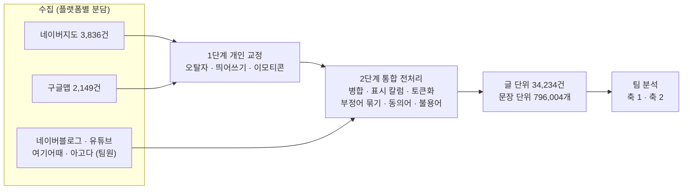

# seoul-hotel-review-analysis

> **Review collection and preprocessing pipeline for Seoul 5-star hotels (Team project).** 34,234 Korean reviews from six platforms are collected, merged, tokenized with Kiwi, and flagged for ads and noise, then used to analyze what guests value and what lowers their ratings.

## 개요

서강대학교 지능형 빅데이터 마케팅(2026-2) 과제 1, 6인 팀 프로젝트.
서울 5성급·프리미엄 호텔 32곳의 리뷰를 6개 플랫폼에서 모아 두 가지 질문을 분석

- **축 1**: 투숙객은 호텔 경험에서 무엇을 중요하게 이야기하는가 (핵심 요소)
- **축 2**: 무엇이 평점을 떨어뜨리는가 (실망 요인)

이 저장소는 팀 프로젝트 중 **담당 부분(팀 공통 데이터 스키마 설계, 네이버지도·구글맵 수집, 6개 플랫폼 통합 전처리)** 의 코드와 문서를 정리한 것.
팀원이 수집한 데이터와 분석 코드는 포함하지 않음

- **인원**: 6명 (수집 4명이 플랫폼별 분담, 분석·시각화 2명이 발표 겸임)
- **데이터**: 네이버블로그, 네이버지도, 구글맵, 여기어때, 아고다, 유튜브 댓글
- **문서**: [통합 전처리 보고서 (PDF)](preprocessing/2_통합/Integrated_Data_Preprocessing_Report.pdf)

## 핵심 결과

분석·시각화는 팀의 분석 담당 2명이 통합 전처리 결과(`tokens` 칼럼)로 진행

| 지표 | 값 |
|---|---|
| 데이터 | 수집 34,241건 → 중복 제거 34,234건 → **기본 분석 대상 31,815건** |
| 평점 리뷰 | 13,323건, 평균 **4.67점**, 3점 이하 661건 |
| 자주 언급되는 요소 (리뷰 플랫폼 언급률) | 객실 **34.8%**, 조식·식음 **34.4%**, 직원·서비스 **33.0%** |
| 언급 시 평점이 높은 요소 | 뷰·분위기 **4.71**, 위치·접근성 **4.68** |
| 부정 표현 1위 | **'아쉽다' 6,217건** (2위 '비싸다' 2,643건의 2배 이상) |
| 3점 이하 리뷰에서 비중 배수 | 직원·응대 **5.4배**, 청결·위생 **4.0배**, 객실 **3.1배** |

자주 언급되는 요소와 평점이 높은 요소가 다르고, 흔한 아쉬움(객실·식음·가격)과 낮은 평점으로 이어지는 불만(직원 응대·청결)도 다르다는 결론.
이 분석은 전처리 단계에서 부정 표현을 `안_좋다`처럼 묶어 둔 덕분에 가능했음 (아래 [통합 전처리](#4-통합-전처리) 참고)

## 전체 흐름



## 데이터

| 플랫폼 | 수집 | 기본 분석 대상 | 평점 |
|---|---|---|---|
| 네이버블로그 | 16,002 | 15,289 | 없음 |
| 아고다 | 4,888 | 4,888 | 있음 |
| 여기어때 | 4,725 | 4,723 | 있음 |
| 네이버지도 (담당) | 3,836 → 3,829 (중복 7건) | 3,829 | 일부 (1,563건) |
| 유튜브 댓글 | 2,641 | 937 | 없음 |
| 구글맵 (담당) | 2,149 | 2,149 | 있음 |
| **합계** | **34,241 → 34,234** | **31,815** | **13,323** |

기본 분석 대상 = `in_period` TRUE, `is_ad` FALSE, `is_noise` FALSE.
기간 밖 1,125건, 광고·협찬 715건, 호텔과 무관한 유튜브 댓글 1,096건은 지우지 않고 표시만 함

## 폴더 구조

| 경로 | 내용 |
|---|---|
| `config.py`, `common.py` | 설정(대상 호텔, 언어·기간 기준), 공통 기능(익명화, 날짜 변환, 한국어 판별, CSV 저장) |
| `import_apify_naver.py`, `import_apify_google.py` | Apify 수집 결과(JSON)를 팀 공통 스키마 CSV로 변환 |
| `hotels_seoul.csv`, `apify/` | 대상 호텔 32곳, Apify 입력값(장소 ID, 수집 상한) |
| `collect_log.csv` | 호텔별 수집·제외 건수 |
| `preprocessing/1_개인교정/` | 오탈자·띄어쓰기·이모티콘 교정 (`preprocess_correct.py`) |
| `preprocessing/2_통합/` | 통합 전처리 코드, 회귀 테스트, 전처리 계획서, 보고서 PDF |
| `preprocessing/2_통합/사전/` | 동의어, 불용어, 사용자 사전, 호텔 별칭 |
| `preprocessing/2_통합/결과/` | 원문이 없는 집계 결과만 (토큰 빈도 Top 300, 불용어·동의어·표현 로그) |

## 담당 역할: 스키마 설계 · 데이터 수집 · 통합 전처리

### 1. 팀 공통 데이터 스키마 설계

플랫폼별로 수집을 나눠 맡은 4명이 같은 형식으로 결과를 내도록 **팀 공통 스키마(8개 칼럼)를 직접 설계**해 공유.
평점 척도·날짜 표기·작성자 정보가 플랫폼마다 달랐지만, 6종 모두 `review_id` 형식·`YYYY-MM-DD` 날짜·5점 기준 평점·16자리 작성자 해시가 같아 통합 단계에서 병합 가능

| 칼럼 | 설명 | 예시 | 설계 이유 |
|---|---|---|---|
| `review_id` | 플랫폼약어_이니셜_일련번호 | NM_DH_000123 | 원본과 전처리 결과를 잇는 키, 담당자·플랫폼을 이름만으로 구분 |
| `platform` | 수집 출처 | 네이버지도 | |
| `hotel_name` | 지도·앱은 페이지에 표시된 호텔명, 블로그·유튜브는 검색에 쓴 호텔명 | 서울신라호텔 | 통합 단계에서 표준 호텔명으로 통일 |
| `review_date` | 작성일 (YYYY-MM-DD) | 2026-07-14 | 플랫폼마다 다른 날짜 표기를 하나로 |
| `rating` | 5점 기준 평점 (10점 척도는 2로 나눠 환산, 블로그·유튜브와 별점 없는 네이버지도 리뷰는 빈칸) | 4.5 | 아고다처럼 10점 척도인 플랫폼이 있어 수집 단계에서 5점으로 통일 |
| `review_text_raw` | 리뷰 원문 그대로 | — | 전처리 전후를 언제든 비교할 수 있게 원문은 손대지 않음 |
| `reviewer_id` | 작성자 닉네임의 SHA-256 해시 앞 16자리 | a3f9c1… | 닉네임 원문 없이 중복 제거 가능 |
| `source_url` | 원본 주소 | — | |

칼럼 흐름: 수집 8개 → 개인 교정에서 `text_clean` 추가 → 통합 결과 13개 (`hotel_name`을 표준명으로 바꾸고 `tokens`·`in_period`·`is_ad`·`is_noise` 추가)

네이버지도·구글맵 수집 코드(`common.py`)는 초기 형식대로 만점 기준 칼럼 `rating_scale`(평점이 있으면 5)도 함께 저장하며, 이 칼럼은 통합 결과에서 빠짐

### 2. 데이터 수집 (네이버지도 · 구글맵)

처음에는 Playwright로 크롤러를 직접 만들었지만 아래 문제로 중단

- 네이버지도: 일반 요청에 429(접속 제한), 브라우저 자동화에 캡차, robots.txt도 장소 페이지 수집을 막음
- 구글맵: 로그인하지 않으면 정렬별 5건만 노출

캡차·로그인 우회는 하지 않고 유료 수집 도구 **Apify의 공개 액터**로 변경
(네이버 `hgservices/naver-maps-reviews-scraper`, 구글 `compass/Google-Maps-Reviews-Scraper`)

- **수집 기준**: 한국어 원문만(본문 한글 비율 20% 이상, 구글 자동 번역문 제외), 2025-01-01 이후 작성분
- **대상 확인**: 장소 주소를 공식 주소와 대조, 같은 건물의 다른 호텔은 이름으로 구분, 호텔 안 식당·바 장소 제외
- **형식 통일**: 사장님 답글 분리, 플랫폼별 날짜 표기를 `YYYY-MM-DD`로 변환
- **익명화**: Apify 입력의 개인정보 옵션(`includePersonalData`, `personalData`)은 중복 제거용 작성자 해시를 만들기 위해서만 켬. 닉네임은 SHA-256 해시 앞 16자리로만 저장하고 원문은 저장하지 않으며, 변환 후 원본 JSON의 개인정보 칸도 삭제

| 플랫폼 | 저장 | 다른 언어 | 본문 없음 | 기간 밖 | 중복 |
|---|---|---|---|---|---|
| 네이버지도 | 3,836 | 127 | 1,674 | 860 | 0 |
| 구글맵 | 2,149 | 2,380 | 2,474 | 2 | 748 |

### 3. 개인 교정 (`preprocess_correct.py`)

원문(`review_text_raw`)은 그대로 두고 교정본을 `text_clean` 칼럼으로 추가

1. **오탈자**: 확실한 오타만 규칙으로 교정 (됬 → 됐, 맛잇어요 → 맛있어요), 줄임말·신조어는 유지
2. **띄어쓰기**: 한글 8자 이상 붙은 어절만 Kiwi로 띄움. 모든 어절에 적용했더니 '5성급 → 5 성급'처럼 맞는 말까지 쪼개져서 범위를 줄임
3. **수동 교정**: 교정본을 읽고 찾은 오류를 목록 파일로 관리
4. **이모티콘 제거**: 지운 자리 앞뒤가 붙으면 한 칸 띄우고, 뒤가 조사면 붙임 (커피☕는 → 커피는)

### 4. 통합 전처리

팀원 데이터까지 6종을 합쳐 같은 설정으로 한 번에 처리 (`preprocess_merge.py`)

| 단계 | 내용 | 결과 |
|---|---|---|
| ① 병합·표시 | 같은 플랫폼 안에서 작성자·작성일·원문이 같은 글 제거, 호텔명 표준화, 기간·광고·노이즈 표시 | 34,241 → 34,234건 |
| ② 공백 정리 | 연속 공백, 줄 앞뒤 공백 정리 | |
| ③ 반복 문자 | 같은 글자 3번 이상 → 2번 (ㅋㅋㅋㅋ → ㅋㅋ) | |
| ④ 토큰화 | Kiwi로 문장 분리·형태소 분석, 내용어만 남기고 기본형으로 | 토큰 약 847만 개 |
| ⑤ 표현 묶기 | 부정·없음·아님 표현과 재방문 의사를 한 토큰으로 | 122,187회 |
| ⑥ 동의어 통일 | 룸·방 → 객실, 풀 → 수영장 등 48개 | 111,324회 |
| ⑦ 불용어 제거 | 경영불용어사전 조정본 + 호텔 도메인 + 호텔 이름 등 315개 | 최종 약 689만 개 |

발표 자료와 보고서에는 동의어가 47개로 적혀 있지만, 최종 사전(`synonyms.csv`)에서 사용하는 항목은 48개

**뜻이 뒤집히는 표현 보존**

형태소 분석 후 '안'·'없다'를 그대로 지우면 "안 좋았다"가 "좋다"로 집계됨.
부정·없음·아님을 앞뒤 단어와 묶고(`안_좋다`, `부담_없다`, `무료_아니다`), "다시 오고 싶다" 같은 재방문 의사는 `재방문` 한 토큰으로 묶음. 이 토큰이 팀 분석 축 2(부정 표현 분석)의 기반

- 팀원 검수에서 '불친절 → 친절', '재방문 의사 없음 → 재방문'처럼 뜻이 뒤집히는 사례 발견
- 원인은 Kiwi가 '불친절'을 접두사 '불' + '친절'로 나누고, 접두사가 품사 거르기에서 빠지는 것. 접두사를 뒤 단어에 붙이도록 수정
- 같은 종류의 문제를 찾기 위해 부정 의미를 만드는 형태소 약 145,000개 중 묶이지 않고 남은 곳을 전부 다시 확인
- 문제가 된 문장을 포함한 **102개 예문을 회귀 테스트**(`test_negation.py`)로 만들어 규칙을 고칠 때마다 확인

**광고·협찬 글 탐지 (블로그)**

- 협찬·제휴 고지문은 1차 교정본에서 지워져 있어서 **원문 기준 정규식**으로 판단. '협찬 없이', '광고 아닙니다' 같은 부정 문장은 제외
- 같은 홍보 문장(20자 이상)이 여러 글·여러 작성자에 반복되는 **반복 템플릿** 탐지
- 715건 표시 (제휴·예약 홍보 616, 반복 템플릿 87, 협찬 64, 겹침 포함)

**유튜브 노이즈 댓글 판정**

"영상 잘 봤어요", "신라면 먹으면서 봅니다"처럼 호텔과 무관한 댓글을 가려냄.
키워드 규칙만으로는 2,641건 중 1,337건을 판정할 수 없어서(애매), **Claude가 전체 댓글을 기준표대로 판정**하고 결과를 사전 파일로 고정. 규칙이 판정한 1,304건 중 최종 판정과 같은 것은 72%

**지우지 않고 표시하기**

기간 밖·광고·노이즈 글을 삭제하지 않고 `in_period`·`is_ad`·`is_noise` 칼럼으로 표시만 함.
분석 목적에 따라 필터를 켜고 끌 수 있고(예: 광고 글끼리 비교), 판단 근거는 로그 파일로 남김

## 사용한 기술

| 영역 | 기술 |
|---|---|
| 수집 | Apify (Naver Maps / Google Maps Reviews Scraper), Python |
| 형태소 분석 | Kiwi (kiwipiepy 0.24) |
| 전처리 | Python (csv, re, hashlib), openpyxl |
| 검증 | 회귀 테스트 (`test_negation.py`), 판단 로그 파일 |

## 실행 방법

```bash
pip install -r requirements.txt

# 회귀 테스트 (데이터 없이 실행 가능)
cd preprocessing/2_통합
python test_negation.py
```

전체 파이프라인(수집 결과 변환 → 개인 교정 → 통합 전처리)은 리뷰 원문 데이터가 있어야 실행됨. 단계별 규칙과 판단 근거는 [PREPROCESSING_PLAN.md](preprocessing/2_통합/PREPROCESSING_PLAN.md) 참고.
리뷰 원문, 수집 원본 JSON, 전처리 결과 데이터는 저장소에 포함 X

## 데이터 공개 범위

- **공개**: 코드, 사전, 원문이 없는 집계 결과(토큰 빈도, 불용어·동의어·표현별 횟수), 문서
- **비공개**: 리뷰 원문, 수집 원본 JSON, 전처리 결과 데이터, 원문 일부가 들어 있는 로그·라벨 파일
- 캡차·로그인 우회 없이 공개 수집 도구를 사용했고, 과제에 필요한 범위(한국어, 기간 한정)만 수집

## 한계

| 한계 | 영향 |
|---|---|
| 블로그 편중 | 기본 분석 대상의 48.1%가 블로그이고 글이 길어 전체 빈도에 큰 영향 |
| 구글맵 기간 차이 | 무료 크레딧 한도로 숏리스트 8곳은 기간 내 전체, 나머지 24곳은 호텔당 최신 140건까지만 수집 |
| 규칙 기반 교정·탐지 | 규칙에 없는 오타는 남아 있고, 문장을 매번 바꿔 쓰는 홍보글은 반복 템플릿으로 잡히지 않음 |
| 유튜브 노이즈 판정 | AI 보조 라벨링이라 판정자에 따라 결과가 달라질 수 있음 |

## AI 활용

- 수집·전처리 코드는 AI 코딩 도구(Claude Code)를 활용해 작성. 수집 기준과 전처리 규칙 설계, 결과 검수는 직접 함
- 유튜브 댓글의 노이즈 최종 판정은 Claude로 진행 (AI 보조 라벨링)

## 참고 자료

- 불용어: 정재학 교수 「경영불용어사전(공개용)」을 호텔 리뷰에 맞게 조정해 사용 ([사전 설명](preprocessing/2_통합/사전/README.md))
- 형태소 분석: [Kiwi (kiwipiepy)](https://github.com/bab2min/kiwipiepy)
- 수집 도구: [Apify](https://apify.com)
